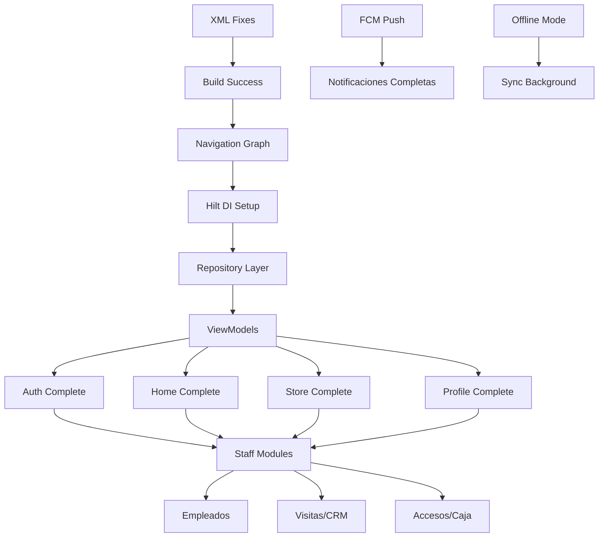

# ApexGym Android - Feature Breakdown

## 📋 Resumen de Features por Módulo

| Módulo | Features Totales | Completadas | En Progreso | Pendientes | % Avance |
|--------|------------------|-------------|-------------|------------|----------|
| **Autenticación** | 8 | 6 | 1 | 1 | 75% |
| **Home / Cliente** | 15 | 10 | 3 | 2 | 67% |
| **Membresía** | 8 | 3 | 2 | 3 | 38% |
| **Tienda / Carrito** | 12 | 5 | 3 | 4 | 42% |
| **Perfil / Config** | 10 | 6 | 2 | 2 | 60% |
| **Empleados (Staff)** | 25 | 0 | 8 | 17 | 0% |
| **Visitas / CRM** | 12 | 0 | 4 | 8 | 0% |
| **Notificaciones** | 8 | 5 | 2 | 1 | 63% |
| **Accesos / Caja** | 15 | 0 | 3 | 12 | 0% |
| **Transversal** | 10 | 2 | 3 | 5 | 20% |
| **TOTAL** | **123** | **37** | **31** | **55** | **30%** |

---

## 🔐 MÓDULO 1: AUTENTICACIÓN

### Features Detalladas

| ID | Feature | Descripción | Estado | Esfuerzo | Dependencias |
|----|---------|-------------|--------|----------|--------------|
| AUTH-01 | **Login Email/Password** | Validación cliente, llamada API, manejo errores, navegación a Home | ✅ Done | 3 SP | API Login |
| AUTH-02 | **Registro Paso 1 - Cuenta** | Email, password, confirmación, validaciones en tiempo real | ✅ Done | 3 SP | API Registro |
| AUTH-03 | **Registro Paso 2 - Datos Personales** | Nombre, apellido, DNI, fecha nacimiento, género | ✅ Done | 3 SP | API Registro |
| AUTH-04 | **Registro Paso 3 - Contacto/Emergencia** | Teléfono, dirección, contacto emergencia, relación | ✅ Done | 3 SP | API Registro |
| AUTH-05 | **Verificación Email** | Código 6 dígitos, reenvío, timer 60s, validación | ✅ Done | 2 SP | API Verificar |
| AUTH-06 | **Logout** | Llamada API, limpieza sesión local, navegación a Login | ✅ Done | 1 SP | API Logout |
| AUTH-07 | **Recuperar Contraseña** | Flujo "Olvidé mi contraseña" - email + token reset | 🟡 En Progreso | 3 SP | Backend nuevo |
| AUTH-08 | **Biometría / PIN** | Login con huella/FaceID + PIN fallback (opcional) | ❌ Pendiente | 5 SP | Crypto, Keystore |

### Criterios de Aceptación (Ejemplo AUTH-01)
- [ ] Email válido (regex RFC 5322 simplificado)
- [ ] Password mínimo 8 chars, 1 mayúscula, 1 número, 1 especial
- [ ] Loading state durante llamada API
- [ ] Error handling: credenciales inválidas, sin red, error servidor
- [ ] Navegación automática a Home en éxito
- [ ] Persistencia sesión (cookies + Room)

---

## 🏠 MÓDULO 2: HOME / CLIENTE (MainActivity + HomeFragment)

### Features Detalladas

| ID | Feature | Descripción | Estado | Esfuerzo | Dependencias |
|----|---------|-------------|--------|----------|--------------|
| HOME-01 | **Bottom Navigation 4 Tabs** | Inicio, Membresía, Tienda, Perfil (via avatar) | ✅ Done | 3 SP | - |
| HOME-02 | **Animated Pill Indicator** | Animación translationX + width (ValueAnimator) | ✅ Done | 3 SP | - |
| HOME-03 | **Tab 0: Inicio - Hero Section** | Saludo personalizado, avatar, membresía activa badge | ✅ Done | 2 SP | API Perfil |
| HOME-04 | **Tab 0: Inicio - QR Access FAB** | FAB extendida, modal fullscreen, timer 45s | ✅ Done | 5 SP | API QR |
| HOME-05 | **Tab 0: Inicio - Productos Populares** | Horizontal scroll, 4 items, navegar a detalle | ✅ Done | 3 SP | API Productos |
| HOME-06 | **Tab 0: Inicio - Action Chips** | Membresía, Tienda, Servicios - navegan a tabs | ✅ Done | 2 SP | - |
| HOME-07 | **Tab 1: Membresía - Estado Actual** | Plan, días restantes, progreso circular, badge | ✅ Done | 3 SP | API Membresía |
| HOME-08 | **Tab 1: Membresía - Historial Planes** | Lista expandible planes previos | 🟡 Parcial | 2 SP | API Membresía |
| HOME-09 | **Tab 1: Membresía - Planes Disponibles** | BottomSheet con lista planes, botón solicitar | ✅ Done | 3 SP | API Planes |
| HOME-10 | **Tab 2: Tienda - Buscador** | SearchView con filtro tiempo real | ✅ Done | 2 SP | - |
| HOME-11 | **Tab 2: Tienda - Category Chips** | Chips dinámicos desde API, filtro visual | ✅ Done | 3 SP | API Categorías |
| HOME-12 | **Tab 2: Tienda - Grid Productos** | GridLayoutManager 2 cols, paginación, LruCache imágenes | ✅ Done | 5 SP | API Productos |
| HOME-13 | **Tab 2: Tienda - Pull to Refresh** | SwipeRefreshLayout en NestedScrollView | 🟡 Parcial | 2 SP | - |
| HOME-14 | **Tab 3: Perfil (BottomSheet)** | Info usuario, editar, notificaciones, logout | ✅ Done | 3 SP | API Perfil |
| HOME-15 | **Estados Vacíos/Error** | Ilustraciones + mensajes + botón reintentar | 🟡 Parcial | 2 SP | - |

---

## 📱 MÓDULO 3: MEMBRESÍA

### Features Detalladas

| ID | Feature | Descripción | Estado | Esfuerzo | Dependencias |
|----|---------|-------------|--------|----------|--------------|
| MEM-01 | **Ver Membresía Activa** | Detalle completo: plan, fechas, precio, beneficios | ✅ Done | 3 SP | API Membresía |
| MEM-02 | **Días Restantes + Progreso** | Cálculo dinámico, barra circular, colores semáforo | ✅ Done | 2 SP | - |
| MEM-03 | **Historial de Membresías** | Lista cronológica planes anteriores | 🟡 Parcial | 2 SP | API Historial |
| MEM-04 | **Planes Disponibles (BottomSheet)** | Comparativa planes, precio, duración, botón "Solicitar" | ✅ Done | 3 SP | API Planes |
| MEM-05 | **Cambiar Plan (Upgrade/Downgrade)** | Prorrateo automático, confirmación, pago diferencia | ❌ Pendiente | 8 SP | API Cambio, Pago |
| MEM-06 | **Renovar Membresía** | Renovación mismo plan, pago, extensión fechas | ❌ Pendiente | 5 SP | API Renovación, Pago |
| MEM-07 | **Cancelar Membresía** | Confirmación doble, política reembolso, fecha fin | ❌ Pendiente | 3 SP | API Cancelación |
| MEM-08 | **Detalle Plan Específico** | BottomSheet con beneficios completos, FAQ | ❌ Pendiente | 2 SP | API Planes |

### Lógica de Negocio - Prorrateo (MEM-05)

```
Fórmula Upgrade:
  Días restantes plan actual × (Precio plan actual / Días plan actual) = Valor residual
  Precio plan nuevo - Valor residual = Diferencia a pagar

Fórmula Downgrade:
  Días restantes plan actual × (Precio plan actual / Días plan actual) = Valor residual
  Valor residual - Precio plan nuevo = Crédito a favor (saldo)
```

---

## 🛒 MÓDULO 4: TIENDA / CARRITO / PAGO

### Features Detalladas

| ID | Feature | Descripción | Estado | Esfuerzo | Dependencias |
|----|---------|-------------|--------|----------|--------------|
| STORE-01 | **Catálogo Productos** | Grid 2 cols, imagen, nombre, precio, stock badge | ✅ Done | 5 SP | API Productos |
| STORE-02 | **Catálogo Servicios** | Lista vertical, duración, precio, entrenador | 🟡 Parcial | 3 SP | API Servicios |
| STORE-03 | **Búsqueda + Filtros** | SearchView + Chips categorías + orden (precio, nombre) | ✅ Done | 3 SP | - |
| STORE-04 | **Detalle Producto (BottomSheet)** | Imagen grande, descripción, stock, selector cantidad, "Agregar" | ✅ Done | 3 SP | - |
| STORE-05 | **Detalle Servicio (BottomSheet)** | Similar a producto + horario disponible | 🟡 Parcial | 3 SP | - |
| STORE-06 | **Carrito Persistente** | BottomSheet lateral, resumen items, subtotal, impuestos, total | ✅ Done | 5 SP | Room/Cache |
| STORE-07 | **Modificar Cantidad Carrito** | +/− botones, swipe to delete, actualización total tiempo real | ✅ Done | 2 SP | - |
| STORE-08 | **Checkout - Selección Método** | Pago Único vs Pago Mixto, validación monto | 🟡 Parcial | 3 SP | - |
| STORE-09 | **Pago Único** | 1 método: Efectivo, Tarjeta, Transferencia, Mixto | 🟡 Parcial | 5 SP | API Pago |
| STORE-10 | **Pago Mixto** | Repartir total entre 2+ métodos, validar suma = total | ❌ Pendiente | 8 SP | API Pago Mixto |
| STORE-11 | **Confirmación Compra** | Ticket digital, número orden, descargar PDF, compartir | ❌ Pendiente | 3 SP | API Ticket |
| STORE-12 | **Historial Compras** | Lista paginada, filtros fecha/tipo, detalle + ticket | ❌ Pendiente | 3 SP | API Historial |

### Métodos de Pago Soportados

| Método | Código | Validación | API Endpoint |
|--------|--------|------------|--------------|
| Efectivo | `EFECTIVO` | Monto exacto / cambio | `/api/pagos/efectivo` |
| Tarjeta | `TARJETA` | Token Stripe/MP / últimos 4 dígitos | `/api/pagos/tarjeta` |
| Transferencia | `TRANSFERENCIA` | CBU/CVU + comprobante imagen | `/api/pagos/transferencia` |
| Mixto | `MIXTO` | Array de pagos parciales | `/api/pagos/mixto` |
| Saldo Cuenta | `SALDO` | Descuento de saldo a favor | `/api/pagos/saldo` |

---

## 👤 MÓDULO 5: PERFIL / CONFIGURACIÓN

### Features Detalladas

| ID | Feature | Descripción | Estado | Esfuerzo | Dependencias |
|----|---------|-------------|--------|----------|--------------|
| PROF-01 | **Ver Perfil** | Nombre, email, teléfono, DNI, fecha nacimiento, foto | ✅ Done | 2 SP | API Perfil |
| PROF-02 | **Editar Perfil** | Formulario validado, guardar cambios, sincronizar | ✅ Done | 3 SP | API Actualizar |
| PROF-03 | **Cambiar Contraseña** | Actual + nueva + confirmar, validación fortaleza | 🟡 Parcial | 2 SP | API Password |
| PROF-04 | **Configurar Notificaciones** | Master toggle, 5 categorías, sonido/vibración/tono, No Molestar | ✅ Done | 5 SP | SharedPrefs |
| PROF-05 | **Historial Accesos** | Lista accesos gimnasio, filtros, exportar CSV | ❌ Pendiente | 3 SP | API Accesos |
| PROF-06 | **Historial Compras** | Ver STORE-12 | ❌ Pendiente | - | - |
| PROF-07 | **Historial Membresías** | Ver MEM-03 | 🟡 Parcial | - | - |
| PROF-08 | **Dispositivos Vinculados** | Lista sesiones activas, revocar acceso | ❌ Pendiente | 3 SP | API Sesiones |
| PROF-09 | **Preferencias App** | Tema (claro/oscuro/sistema), idioma, unidades | ❌ Pendiente | 2 SP | SharedPrefs |
| PROF-10 | **Eliminar Cuenta** | Confirmación triple, GDPR, anonimización datos | ❌ Pendiente | 3 SP | API Delete |

### Configuración Notificaciones (PROF-04 - DETALLADO)

```xml
<!-- fragment_configuracion_notificaciones.xml - 5 Categorías -->
<SwitchMaterial>  <!-- Master: Todas las notificaciones -->
<SwitchMaterial>  <!-- 1. Membresía: Vencimientos, renovaciones, cambios -->
<SwitchMaterial>  <!-- 2. Compras: Confirmaciones, tickets, envíos -->
<SwitchMaterial>  <!-- 3. Promociones: Ofertas, descuentos, eventos -->
<SwitchMaterial>  <!-- 4. Sistema: Mantenimiento, actualizaciones, avisos -->
<SwitchMaterial>  <!-- 5. Recordatorios: Clases, entrenamientos, citas -->

<!-- Sonido -->
<LinearLayout>    <!-- Sonido: Switch + Selector tono (RingtoneManager) -->
<SwitchMaterial>  <!-- Vibración -->
<SwitchMaterial>  <!-- LED (si dispositivo soporta) -->

<!-- Horario No Molestar -->
<TimePicker>      <!-- Inicio: 22:00 default -->
<TimePicker>      <!-- Fin: 08:00 default -->
<SwitchMaterial>  <!-- Activar/Desactivar horario -->
```

---

## 👨‍💼 MÓDULO 6: EMPLEADOS (STAFF)

> **Estado Actual**: 8 Fragments creados como esqueletos con TODOs. Requieren implementación completa.

### Sub-módulos y Features

| Sub-módulo | Fragment | Features Principales | Esfuerzo Total |
|------------|----------|---------------------|----------------|
| **Lista** | `EmpleadosListFragment` | Buscar, filtrar (activo/inactivo/rol), stats cards (total, activos, nuevos), FAB crear | 8 SP |
| **Detalle** | `EmpleadoDetalleFragment` | Info personal, contacto, documentos, horario actual, botones: editar, horario, asistencias, permisos, nómina | 8 SP |
| **CRUD** | `CrearEditarEmpleadoFragment` | Formulario completo: datos personales, contacto, dirección, documentos, foto, rol, sede, estado, validaciones | 13 SP |
| **Horarios** | `HorarioEmpleadoFragment` | Vista semanal/mensual, turnos (mañana/tarde/noche), descansos, copiar semana, plantillas, conflictos visuales | 13 SP |
| **Asistencias** | `AsistenciasEmpleadoFragment` | Historial accesos (entrada/salida), filtros fecha/rango/tipo, estadísticas (puntualidad, horas totales), exportar PDF/Excel | 8 SP |
| **Turnos** | `TurnosEmpleadoFragment` | Asignar turnos, plantillas semanales, detectar conflictos, solicitudes cambio, aprobaciones | 10 SP |
| **Permisos** | `PermisosEmpleadoFragment` | Solicitudes (vacaciones, licencia, enfermedad), aprobar/rechazar, saldo días, calendario visual | 8 SP |
| **Nómina** | `NominaEmpleadoFragment` | Cálculo automático (base + horas extra + bonos - descuentos), generar recibo PDF, historial pagos, exportar | 13 SP |

### Entidad Empleado (Modelo)

```kotlin
data class Empleado(
    val id: Int,
    val legajo: String,              // Código único
    val nombre: String,
    val apellido: String,
    val dni: String,
    val email: String,
    val telefono: String,
    val fechaNacimiento: LocalDate,
    val fechaIngreso: LocalDate,
    val rol: RolEmpleado,            // RECEPCIONISTA, ENTRENADOR, ADMIN, GERENTE, LIMPIEZA
    val sede: Sede,
    val estado: EstadoEmpleado,      // ACTIVO, INACTIVO, SUSPENDIDO, VACACIONES
    val fotoUrl: String?,
    val contactoEmergencia: ContactoEmergencia,
    val documentos: List<Documento>, // DNI, Certificado, Título, etc.
    val horarioBase: HorarioSemanal?,
    val salarioBase: Double,
    val categoria: String,           // Convenio colectivo
    val cuentaBancaria: CuentaBancaria?
)

enum class RolEmpleado { RECEPCIONISTA, ENTRENADOR, ADMIN, GERENTE, LIMPIEZA, MANTENIMIENTO }
enum class EstadoEmpleado { ACTIVO, INACTIVO, SUSPENDIDO, VACACIONES, LICENCIA }
```

---

## 👥 MÓDULO 7: VISITAS / CRM (PROSPECTOS)

### Features Detalladas

| ID | Feature | Descripción | Estado | Esfuerzo |
|----|---------|-------------|--------|----------|
| CRM-01 | **Lista Visitas (Kanban/Lista)** | Columnas: Nuevo → Contactado → Calificado → Propuesta → Cerrado Ganado/Perdido, drag & drop, stats por columna | ❌ Pendiente | 8 SP |
| CRM-02 | **Filtros Avanzados** | Por estado, fecha rango, asesor asignado, origen (web, walk-in, referido, redes), interés | ❌ Pendiente | 3 SP |
| CRM-03 | **Crear Visita** | Formulario: datos prospecto, origen, interés inicial, observaciones, asignar asesor, programar primer seguimiento | ❌ Pendiente | 5 SP |
| CRM-04 | **Detalle Visita** | Timeline completo: contactos, notas, adjuntos, tareas, cambios estado, valor estimado, probabilidad | ❌ Pendiente | 5 SP |
| CRM-05 | **Seguimiento (Contacto)** | Tipo: Llamada, WhatsApp, Email, Visita Presencial, Videollamada; Resultado: Interesado, No contesta, No interesado, Reagendar, Cerrado; Programar próximo | ❌ Pendiente | 8 SP |
| CRM-06 | **Adjuntos/Documentos** | Subir fotos, PDFs, capturas conversación, previsualizar, descargar | ❌ Pendiente | 3 SP |
| CRM-07 | **Tareas/Recordatorios** | Crear tareas vinculadas a visita, notificaciones, completadas | ❌ Pendiente | 3 SP |
| CRM-08 | **Reportes CRM** | Embudo conversión, tiempo promedio cierre, por asesor, por origen, forecast mensual | ❌ Pendiente | 5 SP |
| CRM-09 | **Convertir a Socio** | Botón "Convertir en Cliente" → Pre-llena registro con datos visita | ❌ Pendiente | 3 SP |
| CRM-10 | **Importar/Exportar** | CSV/Excel leads, plantilla importación | ❌ Pendiente | 3 SP |
| CRM-11 | **Notificaciones Automáticas** | Recordatorios seguimiento, alertas prospecto frío (>7 días sin contacto) | ❌ Pendiente | 3 SP |
| CRM-12 | **Dashboard Asesor** | Mis visitas, pendientes, objetivos, comisiones estimadas | ❌ Pendiente | 5 SP |

### Estados Visita (Kanban)

```
NUEVO → CONTACTADO → CALIFICADO → PROPUESTA → CERRADO_GANADO
                              ↘ CERRADO_PERDIDO
                              
Otros estados: REAGENDADO, EN_NEGOCIACION, ESPERANDO_DOCS
```

---

## 🔔 MÓDULO 8: NOTIFICACIONES

### Features Detalladas

| ID | Feature | Descripción | Estado | Esfuerzo |
|----|---------|-------------|--------|----------|
| NOTIF-01 | **Lista Notificaciones** | Paginada (20/page), pull-to-refresh, swipe actions (marcar leída, eliminar), agrupación por fecha | ✅ Done | 5 SP |
| NOTIF-02 | **Detalle Notificación** | Contenido completo, acción contextual (ver membresía, ver compra, etc.), marcar leída automática | 🟡 Parcial | 3 SP |
| NOTIF-03 | **Configuración Global** | Master toggle ON/OFF todas | ✅ Done | 1 SP |
| NOTIF-04 | **Configuración por Categoría** | 5 switches independientes (Membresía, Compras, Promos, Sistema, Recordatorios) | ✅ Done | 3 SP |
| NOTIF-05 | **Sonido y Vibración** | Selector tono (RingtoneManager), switch vibración, preview sonido | ✅ Done | 3 SP |
| NOTIF-06 | **Horario No Molestar** | TimePicker inicio/fin, switch activar, respetar en push reception | ✅ Done | 3 SP |
| NOTIF-07 | **Push Notifications (FCM)** | Token registration, manejo foreground/background, deep links, badge count | ❌ Pendiente | 8 SP |
| NOTIF-08 | **Centro de Notificaciones In-App** | Historial completo, búsqueda, filtros, "Marcar todas leídas" | 🟡 Parcial | 5 SP |

### Categorías de Notificación

| Categoría | Código | Ejemplos | Default |
|-----------|--------|----------|---------|
| Membresía | `MEMBRESIA` | Vence en 3 días, renovada, plan cambiado | ON |
| Compras | `COMPRAS` | Compra confirmada, ticket listo, envío | ON |
| Promociones | `PROMOCIONES` | 2x1 en bebidas, descuento renovación, evento | OFF |
| Sistema | `SISTEMA` | Mantenimiento programado, nueva versión, aviso legal | ON |
| Recordatorios | `RECORDATORIOS` | Clase en 30 min, turno mañana, pago pendiente | ON |

---

## 🚪 MÓDULO 9: ACCESOS Y CAJA (RECEPCIÓN)

### Features Detalladas

| ID | Feature | Descripción | Estado | Esfuerzo |
|----|---------|-------------|--------|----------|
| ACC-01 | **Acceso Manual** | Buscar socio (DNI, nombre, código QR, código barras), validar membresía activa, permitir/denegar con motivo, registrar entrada | ❌ Pendiente | 8 SP |
| ACC-02 | **Detalle Acceso (BottomSheet)** | Foto socio, plan actual, hora entrada, botón "Registrar Salida", ver perfil completo | ❌ Pendiente | 3 SP |
| ACC-03 | **Control Capacidad** | Contador tiempo real, alerta aforo máximo, lista presentes | ❌ Pendiente | 5 SP |
| ACC-04 | **Acceso QR (Escáner)** | Cámara, scan código socio, validación automática, sonido confirmación | ❌ Pendiente | 5 SP |
| ACC-05 | **Historial Accesos Recepción** | Filtros fecha, socio, tipo (entrada/salida), exportar | ❌ Pendiente | 3 SP |
| CAJA-01 | **Apertura Caja** | Monto inicial por denominaciones (billetes/monedas), responsable, observaciones, firmar digital | ❌ Pendiente | 5 SP |
| CAJA-02 | **Movimientos Caja** | Ingresos/egresos, concepto, método, comprobante foto, categorización | ❌ Pendiente | 8 SP |
| CAJA-03 | **Corte Caja** | Resumen ventas por método, arqueo efectivo (conteo denominaciones), diferencias, observaciones, finalizar corte | ❌ Pendiente | 8 SP |
| CAJA-04 | **Cierre Caja** | arqueo final, comparación con sistema, diferencias justificadas, firmar, generar reporte PDF | ❌ Pendiente | 5 SP |
| CAJA-05 | **Historial Cortes** | Lista cortes, filtrar por fecha/responsable, ver detalle, reimprimir | ❌ Pendiente | 3 SP |
| CAJA-06 | **Configuración Caja** | Denominaciones moneda, alertas diferencia (>5%), métodos pago habilitados, impresora ticket | ❌ Pendiente | 3 SP |
| CAJA-07 | **Resumen Apertura** | Vista rápida estado caja actual, último corte, responsable turno | ❌ Pendiente | 2 SP |
| CAJA-08 | **Nuevo Movimiento (Sheet)** | BottomSheet rápido: ingreso/egreso, monto, concepto, método | ❌ Pendiente | 3 SP |
| CAJA-09 | **Dashboard Recepción** | Resumen día: accesos, ventas, caja, pendientes, alertas | ❌ Pendiente | 5 SP |

### Flujo Corte de Caja

```
APERTURA → MOVIMIENTOS (ventas, pagos, egresos) → ARQUEO PARCIAL (opcional) 
→ CORTE → CONTEO DENOMINACIONES → COMPARACIÓN SISTEMA 
→ DIFERENCIAS (justificar) → FIRMAR → GENERAR PDF → CIERRE
```

---

## 🔄 MÓDULO 10: TRANSVERSAL / TÉCNICO

### Features Detalladas

| ID | Feature | Descripción | Estado | Esfuerzo |
|----|---------|-------------|--------|----------|
| TECH-01 | **Splash Screen** | Animated splash, versión app, check updates, navegación auto | ❌ Pendiente | 2 SP |
| TECH-02 | **Onboarding** | 3-4 pantallas carousel, permisos (notificaciones, cámara, ubicación), skip | ❌ Pendiente | 3 SP |
| TECH-03 | **Offline Mode** | Room cache, sync pendiente al reconectar, indicador estado red | ❌ Pendiente | 8 SP |
| TECH-04 | **Deep Links** | `apexgym://qr/123`, `apexgym://membership/456`, `apexgym://store/product/789` | ❌ Pendiente | 3 SP |
| TECH-05 | **App Shortcuts** | Static: "Escanear QR", "Ver Membresía", "Tienda" | ❌ Pendiente | 2 SP |
| TECH-06 | **Widget Home Screen** | Próxima clase, días membresía, acceso rápido QR | ❌ Pendiente | 5 SP |
| TECH-07 | **Crashlytics / Analytics** | Firebase Crashlytics, Analytics events, custom logs | ❌ Pendiente | 3 SP |
| TECH-08 | **Feature Flags** | Remote config (Firebase) para activar/desactivar features | ❌ Pendiente | 3 SP |
| TECH-09 | **Accesibilidad (a11y)** | Content descriptions, talkback, font scaling, contrast ratios | ❌ Pendiente | 5 SP |
| TECH-10 | **Internacionalización (i18n)** | Español (ES/AR), Inglés, Portugués (BR) | ❌ Pendiente | 5 SP |

---

## 📊 Matriz de Esfuerzo por Rol (Story Points)

| Feature | Backend | Android Lead | Android Senior | Android Mid | QA | UX/UI | DevOps | Total SP |
|---------|---------|--------------|----------------|-------------|-----|-------|--------|----------|
| **Auth (8)** | 13 | 5 | 8 | 8 | 5 | 3 | 2 | 44 |
| **Home (15)** | 8 | 8 | 13 | 13 | 5 | 8 | 0 | 55 |
| **Membresía (8)** | 13 | 5 | 13 | 8 | 5 | 3 | 0 | 47 |
| **Tienda/Pago (12)** | 21 | 8 | 21 | 13 | 8 | 5 | 2 | 78 |
| **Perfil/Config (10)** | 8 | 3 | 8 | 5 | 3 | 3 | 0 | 30 |
| **Empleados (8×7=56)** | 40 | 13 | 40 | 26 | 13 | 8 | 2 | 142 |
| **Visitas/CRM (12)** | 21 | 8 | 21 | 13 | 8 | 5 | 2 | 78 |
| **Notificaciones (8)** | 13 | 5 | 8 | 8 | 5 | 3 | 2 | 44 |
| **Accesos/Caja (15)** | 26 | 8 | 21 | 13 | 8 | 5 | 2 | 83 |
| **Transversal (10)** | 5 | 8 | 13 | 8 | 5 | 5 | 8 | 52 |
| **TOTAL** | **168** | **71** | **166** | **115** | **65** | **48** | **20** | **653 SP** |

> **Nota**: 653 SP ≈ 14 semanas × 6 expertos × ~8 SP/semana = 672 SP capacidad teórica. **Viable con buffer ~3%**.

---

## 🎯 Priorización (MoSCoW)

### MUST HAVE (Crítico - Sprint 1-4)
- ✅ AUTH-01 a AUTH-06 (Login, Registro, Logout)
- ✅ HOME-01 a HOME-07 (Home básico, tabs, QR, membresía)
- ✅ STORE-01 a STORE-07 (Catálogo, carrito básico)
- ✅ PROF-01, PROF-02, PROF-04 (Perfil, config notificaciones)
- 🔴 **Fix XML Build Errors** (Bloqueador actual)
- 🔴 **BaseFragment + Compilación Staff**
- 🔴 **Navigation Graph + Hilt Setup**

### SHOULD HAVE (Importante - Sprint 5-8)
- AUTH-07 (Recuperar password)
- HOME-08 a HOME-15 (Estados, pull-refresh, empty states)
- MEM-01 a MEM-04 (Membresía completa)
- STORE-08 a STORE-11 (Checkout, pagos, ticket)
- PROF-03, PROF-05, PROF-09 (Password, historial, preferencias)
- NOTIF-01 a NOTIF-06 (Notificaciones in-app completas)
- CRM-01 a CRM-05 (CRM básico kanban + seguimiento)
- ACC-01, ACC-02 (Acceso manual básico)
- CAJA-01 a CAJA-04 (Caja completa)

### COULD HAVE (Deseable - Sprint 9-12)
- MEM-05 a MEM-08 (Cambio plan, renovación, cancelación)
- STORE-12 (Historial compras)
- PROF-06, PROF-07, PROF-08, PROF-10 (Historiales, dispositivos, eliminar cuenta)
- NOTIF-07, NOTIF-08 (Push FCM + centro in-app)
- CRM-06 a CRM-12 (Adjuntos, reportes, conversión, import/export)
- ACC-03 a ACC-05 (Capacidad, QR escáner, historial recepción)
- CAJA-05 a CAJA-09 (Historial cortes, config, dashboard)
- TECH-01 a TECH-05 (Splash, onboarding, offline, deep links, shortcuts)

### WON'T HAVE (Futuro - Post MVP)
- TECH-06 a TECH-10 (Widget, Crashlytics, Feature flags, a11y, i18n)
- AUTH-08 (Biometría/PIN)
- Empleados: Horarios, Turnos, Permisos, Nómina (completo)
- Staff advanced reporting

---

## 🔗 Dependencias Entre Features



---

## 📝 Definition of Done (Por Feature)

| Criterio | Descripción |
|----------|-------------|
| **Code Complete** | Implementación funcional, sin TODOs, sin código comentado |
| **Code Review** | Aprobado por 1 senior + 1 mid (mínimo) |
| **Unit Tests** | ≥ 80% coverage en ViewModels, Use Cases, Repositories |
| **UI Tests** | Happy path + 2 edge cases por screen (Espresso/Compose) |
| **Lint Clean** | 0 errors, 0 warnings nuevos |
| **Detekt Clean** | 0 violations (config estándar) |
| **Accessibility** | Content descriptions, focus order, contrast AA |
| **Performance** | No ANRs, 60fps scrolling, memoria < 150MB |
| **Documentation** | README feature, API contracts actualizados |
| **QA Sign-off** | Test cases passed en device farm (API 28, 30, 33, 35) |