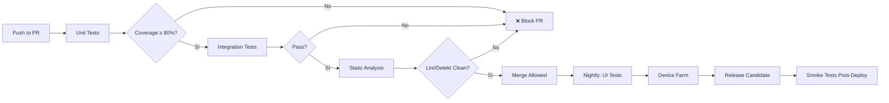

# ApexGym Android - Testing Strategy

## 🎯 Visión General

**Objetivo**: Garantizar calidad, estabilidad y confianza en cada release mediante una pirámide de testing equilibrada, automatización continua y feedback rápido.

```
                    ┌─────────────┐
                    │  E2E / UI   │  ← 10% | Device Farm, Critical Paths
                    │  Tests      │
            ┌───────┴───────┴───────┐
            │   Integration Tests   │  ← 20% | Repository + API, Database
            │   (Repository, API)   │
    ┌───────┴───────┴───────┴───────┐
    │        Unit Tests             │  ← 70% | ViewModels, UseCases, Repos, Mappers
    │  (ViewModel, UseCase, Repo)   │
    └───────────────────────────────┘
```

**Target Coverage**: ≥ 80% (Unit), ≥ 60% (Integration), 100% Critical Paths (UI)

---

## 🧪 Niveles de Testing

### 1. Unit Tests (70% - Fast, Isolated, Deterministic)

#### Qué Testear
| Capa | Componentes | Ejemplos |
|------|-------------|----------|
| **Presentation** | ViewModels, StateFlow/LiveData, UI State transitions | `HomeViewModel`, `LoginViewModel`, `CartViewModel` |
| **Domain** | Use Cases (Interactors), Business Logic | `LoginUseCase`, `CalculateProrrateoUseCase`, `GetMembershipUseCase` |
| **Data** | Repository Implementations, Mappers, Data Sources | `AuthRepositoryImpl`, `ProductMapper`, `FakeAuthDataSource` |
| **Utils** | Extensions, Helpers, Validators, Formatters | `DateUtils`, `CurrencyFormatter`, `EmailValidator` |

#### Stack Tecnológico
```kotlin
// build.gradle.kts (test)
dependencies {
    // Core
    testImplementation("junit:junit:4.13.2")
    testImplementation("org.jetbrains.kotlinx:kotlinx-coroutines-test:1.7.3")
    testImplementation("androidx.arch.core:core-testing:2.2.0")
    testImplementation("androidx.lifecycle:lifecycle-viewmodel-testing:2.7.0")
    
    // Mocking
    testImplementation("org.mockito:mockito-core:5.11.0")
    testImplementation("org.mockito.kotlin:mockito-kotlin:5.1.0")
    testImplementation("com.nhaarman.mockitokotlin2:mockito-kotlin:2.2.0")
    
    // Assertions
    testImplementation("org.assertj:assertj-core:3.24.2")
    testImplementation("com.google.truth:truth:1.1.5")
    
    // Testing Utilities
    testImplementation("com.squareup.okhttp3:mockwebserver:4.11.0")
    testImplementation("androidx.room:room-testing:2.6.1")
}
```

#### Estructura de Tests Unitarios

```kotlin
// presentation/home/HomeViewModelTest.kt
@ExperimentalCoroutinesApi
class HomeViewModelTest {
    
    @get:Rule
    val coroutineRule = MainDispatcherRule()
    
    @get:Rule
    val instantTaskExecutorRule = InstantTaskExecutorRule()
    
    private lateinit var viewModel: HomeViewModel
    private val getHomeDataUseCase = mockk<GetHomeDataUseCase>()
    private val getMembershipUseCase = mockk<GetMembershipUseCase>()
    
    @Before
    fun setup() {
        viewModel = HomeViewModel(getHomeDataUseCase, getMembershipUseCase)
    }
    
    @Test
    fun `loadHomeData emits Loading then Success`() = runTest {
        // Given
        val homeData = HomeData(/* ... */)
        coEvery { getHomeDataUseCase() } returns Result.Success(homeData)
        
        // When
        viewModel.loadHomeData()
        
        // Then
        assertEquals(UiState.Loading(), viewModel.uiState.value)
        advanceUntilIdle()
        assertEquals(UiState.Success(homeData), viewModel.uiState.value)
    }
    
    @Test
    fun `loadHomeData emits Error on failure`() = runTest {
        // Given
        coEvery { getHomeDataUseCase() } returns Result.Error("Network error")
        
        // When
        viewModel.loadHomeData()
        advanceUntilIdle()
        
        // Then
        val state = viewModel.uiState.value as UiState.Error
        assertEquals("Network error", state.message)
    }
}
```

#### Convenciones de Nombrado
```kotlin
// Formato: `methodName_condition_expectedResult`
@Test
fun `login_validCredentials_navigatesToHome`() { }

@Test
fun `login_invalidCredentials_showsError`() { }

@Test
fun `login_networkError_showsOfflineMessage`() { }

// Para sealed classes / state testing
@Test
fun `loadProducts_whenEmpty_showsEmptyState`() { }

@Test
fun `addToCart_whenOutOfStock_showsError`() { }
```

---

### 2. Integration Tests (20% - Real Dependencies)

#### Qué Testear
| Área | Componentes | Herramientas |
|------|-------------|--------------|
| **Repository + Remote** | Retrofit calls, JSON parsing, Error mapping | `MockWebServer`, `WireMock` |
| **Repository + Local** | Room DAOs, Entities, Migrations, Queries | `room-testing`, in-memory DB |
| **Repository + Cache** | LruCache, Disk cache, Expiration | Custom test utils |
| **UseCase + Repository** | Flow transformations, Error handling, Retry | `Turbine` for Flow testing |
| **Hilt Modules** | Dependency graph, Qualifiers, Scopes | `HiltAndroidRule` (instrumented) |

#### Ejemplo: Repository Integration Test

```kotlin
// data/auth/AuthRepositoryImplTest.kt
@HiltAndroidTest
@UninstallModules(AppModule::class)
class AuthRepositoryImplTest {
    
    @get:Rule
    val hiltRule = HiltAndroidRule(this)
    
    @Inject
    lateinit var authRepository: AuthRepository
    
    @Inject
    lateinit var authApiService: AuthApiService
    
    private val mockWebServer = MockWebServer()
    
    @Before
    fun setup() {
        hiltRule.inject()
        mockWebServer.start()
        // Reconfigure Retrofit base URL to mock server
    }
    
    @After
    fun tearDown() {
        mockWebServer.shutdown()
    }
    
    @Test
    fun `login_success_returnsUserAndCachesSession`() = runTest {
        // Given
        mockWebServer.enqueue(MockResponse()
            .setResponseCode(200)
            .setBody("""{"responseFlag":0,"data":{"idCliente":123,"nombre":"Juan"}}""")
            .addHeader("Set-Cookie", "session=abc123; HttpOnly"))
        
        // When
        val result = authRepository.login("juan@email.com", "password123")
        
        // Then
        assertTrue(result is Result.Success)
        val user = (result as Result.Success).data
        assertEquals(123, user.idCliente)
        assertEquals("Juan", user.nombre)
        
        // Verify cookie stored
        val cookies = mockWebServer.takeRequest().headers["Cookie"]
        assertTrue(cookies.contains("session=abc123"))
    }
}
```

#### Room DAO Tests

```kotlin
// db/UsuarioDaoTest.kt
@ExperimentalCoroutinesApi
class UsuarioDaoTest {
    
    private lateinit var database: AppDatabase
    private lateinit var usuarioDao: UsuarioDao
    
    @Before
    fun setup() {
        val context = ApplicationProvider.getApplicationContext<Context>()
        database = Room.inMemoryDatabaseBuilder(context, AppDatabase::class.java)
            .allowMainThreadQueries()
            .build()
        usuarioDao = database.usuarioDao()
    }
    
    @After
    fun tearDown() {
        database.close()
    }
    
    @Test
    fun `insertAndGetUsuario_works`() = runTest {
        val usuario = Usuario(id = 1, nombre = "Juan", email = "juan@test.com", 
            telefono = null, token = "token", fechaRegistro = 0, ultimoAcceso = 0)
        
        usuarioDao.insertUsuario(usuario)
        val retrieved = usuarioDao.getUsuarioById(1)
        
        assertNotNull(retrieved)
        assertEquals(usuario, retrieved!!)
    }
}
```

---

### 3. UI Tests (10% - Critical Paths Only)

#### Qué Testear (Critical Paths Only)

| Flujo Crítico | Pantallas | Prioridad |
|---------------|-----------|-----------|
| **Auth Flow** | Login → Register (3 pasos) → Verify → Home | 🔴 Crítico |
| **Home Navigation** | Tab switching, QR Modal, BottomSheets | 🔴 Crítico |
| **Store → Cart → Checkout** | Product list → Detail → Cart → Payment → Confirmation | 🔴 Crítico |
| **Membership** | View → Change Plan → Pay → Confirm | 🟡 Alto |
| **Staff: Access** | Search Client → Validate → Allow/Deny | 🔴 Crítico |
| **Staff: Cash Register** | Open → Movements → Close → Report | 🟡 Alto |

#### Stack: Espresso + Compose Testing (Híbrido)

```kotlin
// ui/auth/LoginScreenTest.kt
@HiltAndroidTest
@UninstallModules(AppModule::class)
class LoginScreenTest {
    
    @get:Rule(order = 0)
    val hiltRule = HiltAndroidRule(this)
    
    @get:Rule(order = 1)
    val composeTestRule = createComposeRule()
    
    @Inject
    lateinit var navController: NavController
    
    private val mockWebServer = MockWebServer()
    
    @Before
    fun setup() {
        hiltRule.inject()
        mockWebServer.start()
        // Setup navigation graph
        composeTestRule.setContent {
            ApexGymAppTheme {
                NavHost(navController, "login") {
                    composable("login") { LoginScreen(onLoginClick = { }) }
                    composable("home") { HomeScreen() }
                }
            }
        }
    }
    
    @Test
    fun `login_validCredentials_navigatesToHome`() {
        // Given
        mockWebServer.enqueue(MockResponse()
            .setResponseCode(200)
            .setBody(loginSuccessJson))
        
        // When
        composeTestRule.onNodeWithTag("email_field")
            .performTextInput("juan@email.com")
        composeTestRule.onNodeWithTag("password_field")
            .performTextInput("password123")
        composeTestRule.onNodeWithTag("login_button")
            .performClick()
        
        // Then - Wait for navigation
        composeTestRule.waitForIdle()
        composeTestRule.onNodeWithTag("home_screen").assertExists()
    }
}
```

#### Espresso para Views (Legacy Fragments)

```kotlin
// ui/home/HomeFragmentTest.kt
@RunWith(AndroidJUnit4::class)
@HiltAndroidTest
@UninstallModules(AppModule::class)
class HomeFragmentTest {
    
    @get:Rule
    val hiltRule = HiltAndroidRule(this)
    
    @get:Rule
    val activityRule = ActivityScenarioRule(MainActivity::class.java)
    
    @Test
    fun `tabSwitch_updatesContentAndPillAnimation`() {
        // Given - Login first
        loginAndNavigateToHome()
        
        // When - Click Tab 1 (Membresía)
        onView(withId(R.id.tab_membresia)).perform(click())
        
        // Then - Content updated
        onView(withId(R.id.membresia_content)).check(matches(isDisplayed()))
        
        // And - Pill animated (verify translationX changed)
        // Custom matcher for animated view
    }
}
```

---

### 4. Contract Tests (API Compatibility)

#### Pact Consumer-Driven Contracts

```kotlin
// contract/AuthApiContractTest.kt
@ExtendWith(PactConsumerTestExt::class)
class AuthApiContractTest {
    
    @Pact(consumer = "ApexGymAndroid", provider = "ApexGymBackend")
    fun loginPact(builder: PactDslWithProvider): RequestResponsePact {
        return builder
            .given("User exists with valid credentials")
            .uponReceiving("A login request with valid credentials")
            .path("/api/clientes/verificarCredenciales")
            .method("POST")
            .headers("Content-Type", "application/json")
            .body(newJsonBody { o ->
                o.stringType("email", "juan@email.com")
                o.stringType("password", "password123")
            })
            .willRespondWith()
            .status(200)
            .headers("Content-Type", "application/json")
            .body(newJsonBody { o ->
                o.integerType("responseFlag", 0)
                o.stringType("message", "Login exitoso")
                o.object("data", { d ->
                    d.integerType("idCliente", 123)
                    d.stringType("nombre", "Juan")
                    d.stringType("email", "juan@email.com")
                })
            })
            .toPact()
    }
    
    @Test
    @PactTestFor(pactMethod = "loginPact")
    fun `login_contractCompliance`(mockServer: MockHttpServer) {
        val retrofit = Retrofit.Builder()
            .baseUrl(mockServer.url.toString())
            .addConverterFactory(GsonConverterFactory.create())
            .build()
        
        val api = retrofit.create(AuthApiService::class.java)
        val response = api.login(LoginRequest("juan@email.com", "password123")).await()
        
        assertTrue(response.isSuccessful)
        assertEquals(0, response.body()?.responseFlag)
    }
}
```

---

## 📊 Coverage Targets & Gates

### Cobertura Mínima por Capa

| Capa | Métrica | Target | Gate |
|------|---------|--------|------|
| **ViewModels** | Line Coverage | 85% | PR Block |
| **Use Cases** | Branch Coverage | 90% | PR Block |
| **Repositories** | Line Coverage | 80% | PR Block |
| **Mappers** | Line Coverage | 95% | PR Block |
| **Utils/Extensions** | Line Coverage | 90% | PR Block |
| **Overall** | Line Coverage | 80% | Merge Block |

### Quality Gates en CI

```yaml
# .github/workflows/quality-gates.yml
jobs:
  test:
    steps:
      - name: Run Unit Tests
        run: ./gradlew testDebugUnitTest
      
      - name: Check Coverage
        run: |
          COVERAGE=$(./gradlew jacocoTestReport --quiet | grep -oP 'Total.*?(\d+)%' | head -1)
          if [ $(echo $COVERAGE | cut -d'%' -f1) -lt 80 ]; then
            echo "Coverage ${COVERAGE} below 80%"
            exit 1
          fi
      
      - name: Upload Coverage
        uses: codecov/codecov-action@v3
        with:
          flags: unit
          fail_ci_if_error: true
  
  ui-test:
    runs-on: macos-latest  # Para device farm
    steps:
      - name: Run Instrumented Tests
        uses: reactivecircus/android-emulator-runner@v2
        with:
          api-level: 34
          emulator-options: -no-window -gpu swiftshader_indirect
      
      - name: Run UI Tests
        run: ./gradlew connectedDebugAndroidTest
      
      - name: Upload Test Results
        uses: actions/upload-artifact@v3
        with:
          name: ui-test-results
          path: app/build/reports/androidTests/connected/
```

---

## 🤖 Test Automation Strategy

### Test Pyramid Implementation

```
                    ┌─ E2E (5-10 tests) ────┐
                    │  • Auth Flow          │
                    │  • Purchase Flow      │
                    │  • Staff Access Flow  │
                    └───────────────────────┘
           ┌─ Integration (20-30 tests) ──┐
           │  • Repository + MockWebServer │
           │  • Room DAO + In-memory DB    │
           │  • UseCase + Repository       │
           │  • Hilt Module Verification   │
           └──────────────────────────────┘
┌─ Unit (200+ tests) ─────────────────────────────────────────┐
│  • ViewModel Tests (StateFlow, Navigation, Error Handling) │
│  • UseCase Tests (Business Logic, Edge Cases)              │
│  • Mapper Tests (DTO ↔ Domain, Null Safety)                │
│  • Validator/Formatter Tests (Email, Phone, Currency)      │
│  • Extension Function Tests (Date, String, Collections)    │
└─────────────────────────────────────────────────────────────┘
```

### Ejecución por Etapa

| Etapa | Tests | Duración | Trigger |
|-------|-------|----------|---------|
| **Pre-commit** (Local) | Unit (changed files) | < 30s | `git commit` (husky) |
| **PR Validation** (CI) | Unit + Integration | < 5 min | Push to PR |
| **Nightly** | Full Suite + UI | < 30 min | Schedule 02:00 |
| **Release Candidate** | All + Device Farm | < 60 min | Tag `rc-*` |
| **Production** | Smoke Tests | < 10 min | Post-deploy |

---

## 📱 Device Testing Matrix

### Device Farm (Firebase Test Lab)

| Device | API | Form Factor | Tests |
|--------|-----|-------------|-------|
| Pixel 6a | 34 | Phone | All UI Tests |
| Pixel 7 Pro | 34 | Phone | All UI Tests |
| Galaxy S23 | 33 | Phone | All UI Tests |
| Galaxy A54 | 33 | Phone (mid-range) | Critical Paths |
| Pixel Tablet | 34 | Tablet | Layout Tests |
| Foldable (Emulator) | 34 | Foldable | Responsive Tests |

### Configuración Matrix

```yaml
# .github/workflows/device-testing.yml
strategy:
  matrix:
    api: [28, 30, 33, 34]
    device: [pixel_6a, galaxy_s23, pixel_tablet]
    locale: [es_ES, en_US, pt_BR]
    orientation: [portrait, landscape]
```

---

## 🧰 Test Utilities & Helpers

### Test Data Builders (Test Data Factory)

```kotlin
// test/util/TestDataFactory.kt
object TestDataFactory {
    
    fun createUsuario(
        id: Int = 1,
        nombre: String = "Juan",
        email: String = "juan@test.com",
        token: String = "test_token"
    ): Usuario = Usuario(
        id = id,
        nombre = nombre,
        email = email,
        telefono = "+5491123456789",
        token = token,
        fechaRegistro = System.currentTimeMillis(),
        ultimoAcceso = System.currentTimeMillis()
    )
    
    fun createProduct(
        id: Int = 101,
        nombre: String = "Proteína Whey",
        precio: Double = 45000.0,
        stock: Int = 10
    ): Producto = Producto(
        idProducto = id,
        nombre = nombre,
        descripcion = "Descripción test",
        precio = precio,
        stock = stock,
        imagenUrl = "https://test.com/img.jpg",
        categoria = "Suplementos",
        destacado = false
    )
    
    fun createMembresiaCliente(
        id: Int = 789,
        diasRestantes: Int = 71,
        activa: Boolean = true
    ): MembresiaCliente = MembresiaCliente(
        idMembresiaCliente = id,
        idTipoMembresia = 3,
        nombrePlan = "Premium Anual",
        fechaInicio = LocalDate.now().minusDays(300),
        fechaFin = LocalDate.now().plusDays(diasRestantes),
        diasRestantes = diasRestantes,
        activa = activa,
        precio = 120000.0
    )
}
```

### Custom Assertions

```kotlin
// test/util/CustomAssertions.kt
fun UiState<*>.assertSuccess() {
    this shouldBeInstanceOf<UiState.Success<*>>()
}

fun UiState<*>.assertError(expectedMessage: String? = null) {
    val error = this shouldBeInstanceOf<UiState.Error>()
    expectedMessage?.let { assertEquals(it, error.message) }
}

fun UiState<*>.assertLoading() {
    this shouldBeInstanceOf<UiState.Loading>()
}
```

### Test Rules

```kotlin
// test/util/MainDispatcherRule.kt
class MainDispatcherRule : TestWatcher() {
    private val testDispatcher = UnconfinedTestDispatcher()
    
    override fun starting(description: Description) {
        Dispatchers.setMain(testDispatcher)
    }
    
    override fun finished(description: Description) {
        Dispatchers.resetMain()
        testDispatcher.cleanupTestCoroutines()
    }
}
```

---

## 📈 Métricas de Calidad

### Dashboard de Métricas (SonarQube / Codecov)

| Métrica | Target | Actual | Tendencia |
|---------|--------|--------|-----------|
| **Unit Test Coverage** | ≥ 80% | - | ↗️ |
| **Integration Coverage** | ≥ 60% | - | ↗️ |
| **Mutation Testing Score** | ≥ 70% | - | ↗️ |
| **Flaky Test Rate** | < 1% | - | ↘️ |
| **Test Execution Time** | < 5 min (unit) | - | ↘️ |
| **Defect Escape Rate** | < 5% | - | ↘️ |

### Mutation Testing (Pitest)

```kotlin
// build.gradle.kts
plugins {
    id("pl.droidsonroids.pitest") version "1.0.0"
}

pitest {
    targetClasses = ["com.sprm.apexgym.*"]
    mutators = ["CONDITIONALS_BOUNDARY", "INCREMENTS", "INVERT_NEGS", "MATH", "NEGATE_CONDITIONALS", "VOID_METHOD_CALLS"]
    minMutationCoverage = 0.70
    maxMutationsPerClass = 1000
}
```

---

## 🔄 Test Data Management

### Estrategia de Datos de Prueba

| Entorno | Datos | Estrategia |
|---------|-------|------------|
| **Unit Tests** | Synthetic/Builders | In-memory, isolated |
| **Integration Tests** | Controlled fixtures | MockWebServer, In-memory Room |
| **UI Tests** | Seeded test accounts | Dedicated test env, cleanup @After |
| **Device Farm** | Production-like | Anonymized subset, reset per run |
| **Staging** | Realistic subset | Daily sync from prod (anonymized) |
| **Production** | N/A | No test data |

### Test Accounts

| Rol | Email | Password | Propósito |
|-----|-------|----------|-----------|
| Cliente Activo | `test.cliente.activo@apexgym.com` | `Test123!` | Happy paths |
| Cliente Vencido | `test.cliente.vencido@apexgym.com` | `Test123!` | Membresía expirada |
| Cliente Sin Membresía | `test.cliente.sinplan@apexgym.com` | `Test123!` | Onboarding plan |
| Staff Recepción | `test.staff.recepcion@apexgym.com` | `Test123!` | Accesos, Caja |
| Staff Entrenador | `test.staff.entrenador@apexgym.com` | `Test123!` | Horarios, Asistencias |
| Admin | `test.admin@apexgym.com` | `Test123!` | Reportes, Config |

---

## 📝 Test Documentation

### Test Case Template

```markdown
## TC-<MODULE>-<NNN>: <Descripción Breve>

**Módulo**: <Auth | Home | Store | Membership | Staff>
**Prioridad**: <Crítica | Alta | Media | Baja>
**Tipo**: <Unit | Integration | UI | Contract>
**Precondiciones**:
- Usuario logueado como <rol>
- Estado de membresía: <activa/vencida/sin>
- Carrito: <vacío/con items>

**Pasos**:
1. Navegar a <pantalla>
2. Realizar <acción>
3. Verificar <resultado>

**Resultado Esperado**:
- UI muestra <estado>
- API llamada: <endpoint> con <payload>
- Navegación a: <destino>
- Estado persistido: <qué>

**Datos de Prueba**: <referencia a TestDataFactory>
**Automatizado**: <Sí/No>
**Etiquetas**: <smoke, regression, critical-path>
```

---

## 🚀 Continuous Testing en CI/CD

### Pipeline de Testing



### Feedback Loop Times

| Nivel | Tiempo Objetivo | Real (Target) |
|-------|-----------------|---------------|
| **Pre-commit** | < 30s | 15s |
| **PR Validation** | < 5 min | 3 min |
| **Nightly Full** | < 30 min | 20 min |
| **Release Candidate** | < 60 min | 45 min |

---

## 📋 Checklist de Testing por Feature

### Antes de Marcar Feature como "Done"

- [ ] **Unit Tests**: ViewModel + UseCase + Repository + Mappers ≥ 80%
- [ ] **Integration Tests**: Repository + API (MockWebServer) + Room
- [ ] **UI Tests**: Happy path + 2 edge cases (si critical path)
- [ ] **Contract Tests**: API endpoints cubiertos (Pact)
- [ ] **Accessibility**: TalkBack, contraste, escalado fuentes
- [ ] **Performance**: Sin leaks, 60fps scroll, memoria < 150MB
- [ ] **Edge Cases**: Offline, empty states, error states, loading
- [ ] **Device Testing**: Probado en 2+ dispositivos (API 28, 34)
- [ ] **Regression**: Tests existentes pasan
- [ ] **Documentation**: Test cases documentados, README actualizado

---

## 🛠️ Herramientas y Versiones

| Herramienta | Versión | Propósito |
|-------------|---------|-----------|
| JUnit | 4.13.2 | Unit testing framework |
| Mockito | 5.11.0 | Mocking |
| MockK | 1.13.12 | Kotlin mocking (alternativa) |
| MockWebServer | 4.11.0 | HTTP mocking |
| Room Testing | 2.6.1 | In-memory DB |
| Espresso | 3.5.1 | UI testing (Views) |
| Compose Testing | 1.5.11 | UI testing (Compose) |
| Turbine | 0.11.0 | Flow testing |
| Pact JVM | 4.5.0 | Contract testing |
| Pitest | 1.15.0 | Mutation testing |
| Jacoco | 0.8.11 | Coverage reporting |
| Firebase Test Lab | Latest | Device farm |
| LeakCanary | 2.12 | Memory leaks (debug) |